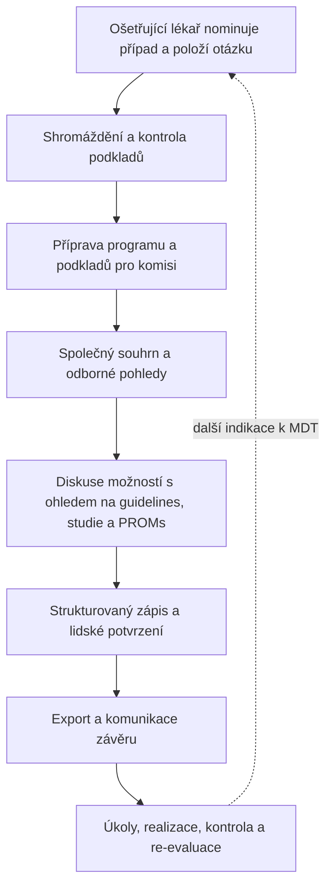
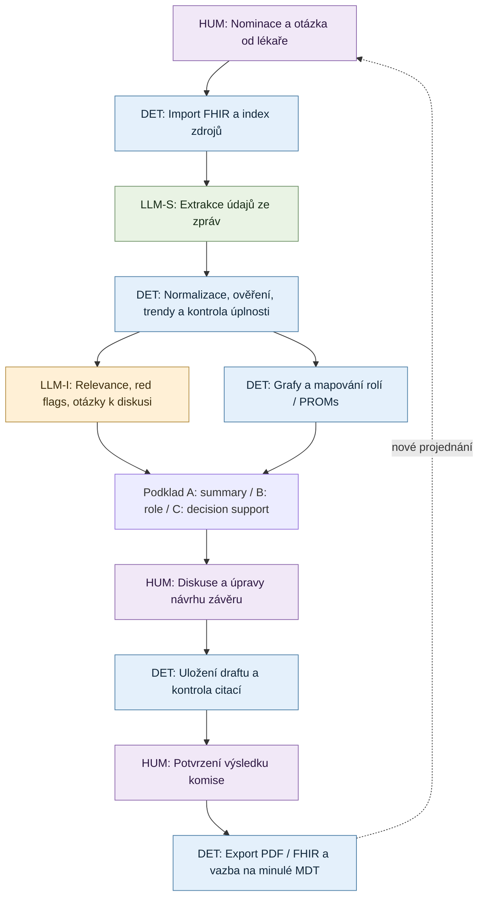

# MDT Copilot — průběh onkologického konzilia a zapojení aplikace

**Projekt:** Rakathon 2026 / MDT Copilot (Asseco CE)  
**Stav:** pracovní procesní model, 16. 10. 2026  
**Účel:** společný kontext pro návrh produktu, frontend, backend a vývojové AI agenty  
**Související soubor:** `MDT_COPILOT_CONTEXT.md` (úplnější kontext zadání, dat a tří konzultací)

> **Status zdrojů:** Část I je rekonstrukcí **oficiálního zadání**. Část II je rekonstrukcí **tří neformálních konzultací**, především rozhovoru s medičkou, a popisuje pozorovanou praxi, nikoli univerzální předpis. Část III je **naším návrhem produktu** a technického workflow; nejde o schválenou implementační specifikaci. Zadání je označeno `CONFIDENTIAL (by Asseco CE)`; před publikováním odvozených materiálů ve veřejném repozitáři ověřit možnost jejich sdílení.

---

# I. Proces MDT podle oficiálního zadání výzvy

Zadání chápe multidisciplinární onkologický tým (MDT, indikační onkologická komise) jako **uzavřený proces před jednáním, během jednání a po něm**, nikoli pouze samotnou poradu. Případ bývá projednán přibližně za **3–5 minut** a společný souhrn by měl umožnit orientaci asi do **30 sekund**.

## I.1 Před zasedáním: nominace a příprava

1. **Ošetřující lékař nominuje pacienta** na MDT a zadá **konkrétní klinickou otázku** (důvod projednání).
2. Shromažďují se podklady: zejména **histologie, staging, biomarkery, léčebná historie, aktuální stav, zobrazovací a laboratorní výsledky, pacientské dotazníky (PROMs)** a předchozí závěry MDT.
3. **Kontroluje se úplnost podkladů.** Neúplný případ může vyžadovat doplnění, případně podmíněné projednání. Samostatný semafor *Case Readiness* je v zadání **BONUS**.
4. **Připraví se program zasedání.** Zadání uvádí sestavení programu, ale **neurčuje přesný algoritmus řazení případů ani proceduru výběru lékařů do komise**.
5. Pro členy MDT se připraví **společný přehled a specializované odborné sekce**; systém musí umožňovat jejich konfiguraci.

## I.2 Během zasedání: orientace, odborná diskuse, rozhodnutí

1. **Společná orientace v případu:** hlavní diagnóza, aktuální stav, ECOG hodnocené lékařem i odpovídající pacientem hlášená soběstačnost, důvod nominace, **otázka pro MDT**, chronologie onemocnění.
2. **Odborné pohledy:** jednotliví specialisté pracují s informacemi relevantními pro svou profesi (např. onkologie, chirurgie, radiologie, patologie); zadání požaduje **nejméně tři odborné role**. PROMs a preference pacienta mají být zohledněny, nikoli ignorovány.
3. **Kontrola problematických zjištění:** významné nesrovnalosti, chybějící informace, red flags a jejich ověřitelné podklady.
4. **Diskuse o možnostech:** příslušné pasáže dodaných doporučených postupů, potenciální vhodnost pro klinické studie, důsledky a preference pacienta. Předběžný screening studií rozlišuje **splněné / nesplněné / neověřitelné pro chybějící údaje** kritérium.
5. **Zápis závěru:** během zasedání nebo na jeho konci je možné vyplňovat a upravovat strukturovaný záznam: zvažované možnosti, zvolený postup, zdůvodnění, přítomné odbornosti a členy, případná odlišná stanoviska, vztah ke guidelines/studii, doporučený další postup a re-evaluaci.
6. **Potvrzení rozhodnutí lidmi:** AI smí sumarizovat, upozorňovat a navrhovat podklady, ale **sama nerozhoduje o léčbě**; nepotvrzený návrh AI musí být vizuálně odlišen od potvrzeného závěru.

> **Co zadání výslovně neurčuje:** pevné pořadí vyjadřování lékařů, způsob dosažení konsenzu, pravidla hlasování či povinnost podpisu všech členů. Obsahuje nicméně pole pro odlišná stanoviska a možnost potvrzení závěru předsedou.

## I.3 Po zasedání: realizace a další průběh

1. Závěr se **uloží jako potvrzený strukturovaný záznam** a spolu s podklady se **exportuje**, například do PDF nebo zprávy HL7 FHIR pro zdravotní dokumentaci.
2. Výsledek je **komunikován pacientovi a ošetřujícím lékařům** (procesní cíl; automatické generování pacientského shrnutí je BONUS).
3. Navazují **konkrétní úkoly, odpovědnosti, termíny, kontrola realizace a plánovaná re-evaluace**. Plnohodnotné sledování realizace v aplikaci je BONUS.
4. Podle vývoje nemoci a výsledků léčby může být pacient **na MDT znovu nominován**; nové projednání vychází také z předchozích závěrů.

## I.4 Souhrn oficiálního procesu

---

# II. Praktický průběh podle tří konzultací

Tato rekonstrukce se nejvíce opírá o **třetí konzultaci s medičkou**, dále o první konzultaci k systému InterSystems a druhou konzultaci o rolích a odborných pohledech. Rozdílné popisy zachováváme jako **varianty či nevyjasněné body**.

## II.1 Složení komise a role

- **Komise nemá pevné složení.** V praxi popsané medičkou bývá onkolog, chirurg a radiolog, podle diagnózy často patolog, internista, gastroenterolog nebo další relevantní specialista. Je přítomen také **koordinátor**. Jde o popis této praxe, nikoliv o povinnou univerzální sestavu.
- **Odesílající / nominující lékař** předává odbornou otázku komisi; nemusí být totožný s referujícím lékařem nebo předsedou.
- **Koordinátor** shromažďuje dokumentaci, připravuje handout, strukturovaný formulář a podklady. V průběhu jednání často zapisuje.
- **Referující lékař** případ ústně prezentuje; může jím být jeden z přítomných odborníků, ideálně dobře znalý dané oblasti.
- **Odborní členové** prezentují své stanovisko a vzájemně se doptávají. Autor histologického nálezu nemusí být týmž patologem, který zasedá v komisi.
- **Předsedající** vede jednání, často je jím onkolog; přesný mechanismus přidělení nebyl popsán. Mentor 1 připustil i roli koordinátora onkologické léčby v předsedání.
- **Pacient** obvykle není jednání přítomen, ale někdy se zasedání účastní a poslouchá diskusi. Nezaměňovat tuto účast za souhlas s konkrétní léčbou.
- **Přístupová práva** jednotlivých lékařů jsou samostatný organizační/technický problém. Mentor 2 popisuje správce oprávnění a individuální přístupy k pacientům, ale výběr lékařů ani produkční správu jejich přístupů nedoporučuje jako jádro MVP.

## II.2 Před jednáním

1. Pacient je vyšetřován a léčen; odborník identifikuje **nejistotu, nejednoznačný nález nebo rozhodovací problém** (např. operace versus systémová léčba, povaha nového ložiska, další linie léčby).
2. Nominující lékař předává **otázku, klíčové klinické skutečnosti a dostupné dokumenty**.
3. **Zjišťují se preference pacienta**, včetně případného odmítnutí léčebné modality; tyto informace se zapisují již do úvodních podkladů. Pacient může být s navrhovanými možnostmi seznámen před MDT a někdy se s ním o nich znovu jedná až po MDT.
4. Koordinátor získá rozsáhlou dokumentaci, **vytvoří z ní handout / strukturovaný formulář** a rozešle či zpřístupní podklady odborníkům.
5. Odborníci by se ideálně měli předem seznámit s dokumentací a **pacienta osobně vidět**, avšak druhé neplatí vždy.
6. **Sestava komise a její organizace** závisí na diagnóze a pracovišti. Třetí konzultace nepopisuje konkrétní algoritmus sestavování programu ani výběru předsedy.

## II.3 Přímo na zasedání

1. **Referování případu:** příslušný lékař představí otázku, stav pacienta, dosavadní léčbu a hlavní podklady.
2. **Společná revize důkazů:** členové prohlížejí relevantní zprávy a zobrazovací snímky a porovnávají nálezy. Ve **dodaném hackathonovém datasetu nejsou DICOM snímky**, jen jejich textové popisy.
3. **Vyjádření odborníků:** jednotliví členové představují své hodnocení. Pro závěr často potřebují vysvětlení od jiné odbornosti, a proto následuje **živá mezioborová diskuse a dotazy**.
4. **Průběžný zápis:** klíčové údaje, návrhy a rodící se závěr se doplňují do **tabulky/formuláře již během diskuse**, často koordinátorem.
5. **Shoda / konečný závěr:** dle medičky se hledá **konsenzus** a při neshodě diskuse pokračuje; uvedla i podpis všech a požadavek souhlasu všech přítomných. Délka komplikované diskuse se může natáhnout až přibližně na **20 minut**.
6. **Potvrzení závěru:** podle první konzultace „rozhoduje vedoucí komise“, podle třetího rozhovoru je výsledkem konsenzus. Oficiální zadání dovoluje zaznamenat i **odlišná stanoviska**. Tyto popisy tedy **nejsou beze zbytku slučitelné** a nemají být bez ověření zakódovány jako jediný režim schvalování.

## II.4 Po zasedání, pacient a opakovaná MDT

1. Pacientovi se vysvětlí doporučený postup a jeho alternativy. **Odborně doporučená možnost může být jiná než pacientem přijatelná možnost**; například pacient odmítne operaci, přestože ji MDT preferuje. Komise může zaznamenat doporučení a alternativu či podmínku, pacienta znovu pozvat a důvody vysvětlit.
2. Rozlišení v dokumentaci: **doporučení MDT × pacientova preference/odmítnutí × skutečně dohodnutý plán × realizovaná léčba**. Jeden stav nesmí automaticky nahrazovat druhý.
3. Závěr, plán a navazující činnosti se dokumentují a mohou se propsat do nemocniční dokumentace / NIS (v první konzultaci zazněla možnost integrace přes FHIR server InterSystems IRIS).
4. **Tentýž pacient se může vracet na MDT** po operaci, po určité době léčby, po restagingu či při nové komplikaci. Při opakovaném projednání se vychází z **předchozích závěrů, jejich realizace a nových dat**.
5. Organizace se může **lišit i mezi komisemi téže nemocnice**. Přítomnost pacienta, přesné role, zápis a schvalování tedy nejsou univerzální konstanty.

## II.5 Hlavní nejistoty k potvrzení s mentory

- **Kdo skutečně schvaluje?** Předsedající, všichni přítomní, nebo lokálně definovaný mechanismus? Jsou odlišná stanoviska slučitelná s potvrzeným závěrem?
- **Kdo může závěr editovat?** Koordinátor, referující lékař, předsedající či všichni?
- **Jak se eviduje odmítnutí léčby pacientem?** Před MDT, po MDT, obojí, s jakým následným postupem?
- **Co přesně znamená „program zasedání“?** Pořadí pacientů na jednání, soupis témat k jednomu případu, nebo obojí?
- **Které role mají vidět co?** UI preference a zpřístupnění dokumentace jsou odlišné od backendové autorizace.

---

# III. Navržený proces se zapojením MDT Copilotu

## III.0 Legenda: **kdo a jak provádí jednotlivé operace**

Každý krok níže má viditelný technický štítek, aby se v návrhu ani implementaci nezaměňovaly **přímé datové operace**, **LLM zpracování textu** a **LLM klinická interpretace**.

| Štítek | Kategorie | Co znamená | Typický příklad |
| --- | --- | --- | --- |
| **`[DET]`** | **Deterministický program** | Parsování, pevné filtry/lookupy, transformace, výpočty a pravidla s reprodukovatelným výsledkem pro stejný vstup a konfiguraci. | Načtení FHIR, převod Base64, porovnání hodnot, graf trendu, kontrola stáří CT, zápis/export. |
| **`[LLM-S]`** | **LLM: soft derivace / extrakce** | Výběr, extrakce, přeuspořádání nebo věrná parafráze **explicitně uvedených informací**. Nepřidává nové klinické závěry. | Z textu zprávy vybrat čas a popis léčby, zkrátit původní otázku, sestavit věcnou chronologii. |
| **`[LLM-I]`** | **LLM: interpretace / syntéza / inference** | Propojování různých faktů, posuzování klinické relevance, formulace vysvětlení a **podmíněných** možností postupu. Může vytvářet odvozené závěry, proto vyžaduje silnější kontrolu. | Propojit únavu + laboratorní anémii, interpretovat rozpory, vybrat diskusní otázky, zhodnotit relevanci guidelines. |
| **`[HUM]`** | **Člověk** | Rozhoduje, opravuje, určuje konfiguraci a potvrzuje klinické závěry. | Ošetřující lékař formuluje otázku, odborníci vedou diskusi, komise schválí doporučení. |

**Kategorie označují operaci, ne celý modul.** Jedna obrazovka může obsahovat výstupy `[DET]`, `[LLM-S]` i `[LLM-I]`; konkrétní tvrzení musí mít vlastní **původ, stav ověření a případně míru nejistoty**. „Soft“ operace LLM stále mohou chybovat a vyžadují validaci. Deterministické pravidlo také nemusí být klinicky správné, pokud je postavené na neplatném nebo nesprávně extrahovaném vstupu.

**Odlišné jsou i původy důkazů:** `[DATA]` = údaj z dokumentace pacienta; `[GUIDE]` = pasáž dodaných doporučených postupů; `[TRIAL]` = kritérium klinické studie. Tyto značky jsou **typem zdroje**, nikoli způsobem výpočtu.

## III.1 Vstup do našeho workflow: existující nominace, bez výběru lékařů

1. **`[HUM]` Mimo náš MVP:** ošetřující lékař **nominuje pacienta, stanoví klinickou otázku** a organizace určí komisi a termín. **Naše aplikace pro první verzi tento organizační proces neřídí.**
2. **`[DET]`** Aplikace načte existující nominaci (`ServiceRequest`, `Task`), otázku, termín MDT a případně přítomné role z konfigurace / dřívějších záznamů. Neexistující otázku označí jako **chybějící**.
3. **`[LLM-S]`** Volitelně nabídne **věrné zpřesnění a zestručnění otázky**, přičemž uloží i její originál. **Nesmí vymyslet jinou otázku ani přidat nové klinické předpoklady.**
4. **`[HUM]`** Referující/ošetřující lékař navržené přeformulování případně potvrdí.

**Výstup:** `case_id`, `mdt_date`, `original_question`, volitelně `proposed_question`, `question_status`, případně `configured_roles`.

## III.2 Načtení, sjednocení a kontrola zdrojových podkladů

1. **`[DET]`** Import FHIR R4 `Bundle`; validace základní struktury a referencí; dekódování vložených zpráv z Base64; index `resourceType/id`, data, autora a typu záznamu.
2. **`[DET]`** Sjednocení strukturovaných údajů (diagnózy, TNM, biomarkery, ECOG, podání léčby, laboratoř, PROMs v obou časech). Chronologické řazení při **zachování původních zdrojů**.
3. **`[LLM-S]`** Ze zpráv v přirozeném jazyce extrakce faktických údajů, které nejsou ve strukturovaných polích: data, léčebné linie, symptomy, rozměry ložisek, preference, omezení. Každý extrahovaný údaj nese **přesnou citaci a stav ověření**.
4. **`[DET]`** Prověření typu/jednotek, časové návaznosti, duplicit a chybějících polí. Případné konflikty různých zdrojů **nepřepisovat jednou „správnou“ hodnotou**.
5. **`[LLM-I]`** Jen pro nejednoznačné rozpory navrhnout interpretaci nebo potřebu doplnění podkladů; uchovat více hypotéz a jejich důkazy.

**Výstup:** jednotný **evidence model / fact store** s identifikátory a původem faktů. Tento model musí být společným zdrojem pro všechny další UI sekce.

## III.3 Kontrola úplnosti a připravenosti případu

1. **`[DET]`** Podle známé diagnózy a otázky zkontrolovat seznam potřebných podkladů a explicitní limity z dostupných guidelines, např. datum posledního relevantního stagingu. V rozporu s fakty nelze automaticky dosadit „v normě“.
2. **`[DET]`** Pokud potřebný údaj **v datasetu již existuje jinde**, připojit ho z jiného zdroje a přidat citaci. Pokud **neexistuje**, označit jako „nenalezen v dostupných datech“.
3. **`[LLM-S]`** Rozpoznávat případy, kdy je údaj přítomen jen ve volném textu, a extrahovat ho (s ověřením).
4. **`[LLM-I]`** Navrhnout, **které chybějící informace mohou být pro položenou otázku klinicky rozhodující**. Odlišit pevnou povinnost od kontextového doporučení.
5. **`[HUM]`** Lékař či koordinátor zhodnotí, zda pokračovat, případ doplnit nebo projednat podmíněně.

**Výstup:** seznam `missing_or_stale_evidence` s důvodem a zdrojem pravidla. Samostatný **Case Readiness semafor je BONUS**, i když základní kontrola podkladů zapadá do workflow.

## III.4 Program zasedání a konfigurace odborných pohledů

Zásadně rozlišujeme:

- **A. Program celého zasedání:** pořadí více pacientských případů, časy a logistika. **`[HUM]`** Primárně mimo MVP. **`[DET]`** Lze zobrazit importovaný seznam případů a seřadit jej podle ručně zadaných parametrů. **`[LLM-I]`** Navrhovat pořadí případů by byl volitelný nadstavbový scénář, nikoli povinnost zadání.
- **B. Agenda jednoho případu:** hlavní rozhodovací otázka, nejdůležitější nejasnosti, relevantní odborné pohledy a body k diskusi. **`[DET]`** Vychází z konfigurovatelné šablony, **`[LLM-I]`** může navrhnout podotázky podle klinického kontextu.
- **C. Složení komise:** konkrétní lékaře vybírá organizace. **`[HUM]`** Pro MVP přebíráme zadané role. **`[LLM-I]`** Případný návrh *chybějící odbornosti* lze označit jako doplňkové upozornění, ale **nevytváříme automatický staffing ani správu personálu**.

**`[HUM]` + `[DET]`** Administrátor nebo předsedající nastaví, které sekce zobrazovat, jejich pořadí, úroveň detailu a přítomné odbornosti. Oficiální minimum jsou **3 role**; podle mentora 2 je vhodný pracovní cíl **4 role (onkologie, chirurgie, radiologie, patologie)**. Důležitá je konfigurace, nikoli jejich trvalé zafixování.

**Pozor:** *preference pohledu v UI* ≠ *oprávnění k pacientským datům*. Pro MVP lze přepínat perspektivy; skrytí sekce ve frontendu nenahrazuje backendovou autorizaci.

## III.5 Hlavní podklad („handout“) pro MDT

**A. MDT Executive Summary (pro všechny)**

- **`[DET]`** Identifikace případu, původní otázka, základní strukturované diagnózy, poslední relevantní měření a datace.
- **`[LLM-S]`** Věrné, stručné shrnutí dosavadního průběhu, hlavní aktuální situace a důvodu projednání; nesmí zamlčet známý rozpor.
- **`[DET]`** Přehledné **grafy a klinická timeline** ze správně datovaných faktů: hlavní události, léčebné linie, významné laboratorní a PROMs trendy, měření ložisek, předchozí MDT.
- **`[DET]`** Vedle sebe **ECOG od lékaře a pacientem uvedená soběstačnost**; srovnání a časový trend.
- **`[LLM-I]`** Stručně vybrat **nejdůležitější klinické problémy a nejistoty** relevantní k otázce, jasně oddělené od přímo naměřených faktů.
- **`[HUM]`** Koordinátor/odborník si může souhrn zkontrolovat či otevřít zdroje.

**B. Specializované pohledy (konfigurovatelné)**

- **`[DET]`** Výchozí sada rolí a **deklarativní mapa relevance zdrojů a položek PROMs**. Stejný údaj může patřit více odbornostem a stále zůstat dostupný ve společném přehledu.
- **`[LLM-S]`** Věrná faktografická sumarizace pro jednotlivé role, například:
  - **Onkologie:** léčebné linie, biomarkery, medikace, toxicita, symptomy, preference.
  - **Chirurgie:** resekabilita, TNM, operační výkony, komorbidity a funkční zdatnost pacienta.
  - **Radiologie:** časová osa zobrazování, nálezy, rozměry ložisek a jejich změny.
  - **Patologie:** histologické typy, grade, biomarkery, rozdíly mezi vzorky.
- **`[LLM-I]`** Ke každé roli doplnit **odborně relevantní otázky, problémy či nejistoty**, bez přidávání nepodložených skutečností.
- **`[DET]`** Personalizace pořadí, viditelnosti a detailu sekcí podle nastavení. Zde se **neřeší automatické přidělování lékařů**.

**C. Decision Support Panel (samostatná součást podkladu)**

- **`[DET]`** Vyhledání, indexování a citování číslovaných pasáží dodaných guidelines a kritérií všech relevantních fiktivních studií.
- **`[LLM-I]`** **Podmíněná nabídka možností léčby** odvozená *z konkrétních poskytnutých pasáží*, nikoliv z paměti modelu; vysvětlit vztah k diagnóze, stadiu, biomarkerům, předchozí terapii a preferencím.
- **`[DET]` + `[LLM-S]`** Screening jednotlivých inclusion/exclusion kritérií studií: přímo z čísel a kódů rozhodovat deterministicky, nezbytné textové údaje nejprve extrahovat. Každé kritérium má stav **splněno / nesplněno / chybí údaj** (a u exclusion kritérií explicitně, zda je *přítomen důvod vyřazení*). Rozporná data znamenají nejistotu, ne automatické splnění.
- **`[LLM-I]`** Vytvořit **2–3 relevantní otázky pro diskusi**, včetně nevyjasněných podmínek studií a potřebných vyšetření.
- **`[HUM]`** Komise rozhodne, které možnosti a studie mají skutečný klinický smysl; „potenciálně vhodná studie“ **není** záruka zařazení.

**D. Red flags / upozornění napříč celým podkladem**

- **`[DET]`** Rozdíly mezi dvěma datovanými hodnotami, prahové hodnoty, chybějící biomarkery, rozpor mezi explicitními kódy, stáří záznamů, ECOG vs. PROMs, základní screening neúplnosti.
- **`[LLM-I]`** Kontextová interpretace **kombinací zjištění**: například vysoká pacientem hlášená únava + pokles Hb; nový lokalizovaný symptom + známé ložisko; konfliktní staging mezi dokumenty. AI musí citovat všechny opěrné zdroje a nesmí z red flagu vyvozovat definitivní diagnózu.
- **`[DET]`** Zobrazit závažnost, zdroje a jejich data, nejistotu a stav kontroly. **`[HUM]`** Lékař upozornění ověří či zamítne s odůvodněním.

> **Rozdíl v terminologii:** „`[LLM-S]` vybralo údaj“ je **tvrzení o obsahu dokumentu**. „`[LLM-I]` považuje dvě skutečnosti za klinicky související“ je **odvozené tvrzení**, vyžadující silnější zdůvodnění a lidskou kontrolu. Zkrácení původního textu může samo změnit význam; přesnost parafráze je třeba testovat.

## III.6 Diskuse na jednání a průběžný záznam

1. **`[HUM]`** Referující lékař představí případ, ostatní odborníci se vyjádří a vzájemně doptávají. Aplikace **neřídí pořadí promluv ani automaticky neurčuje vítěznou léčbu**.
2. **`[DET]`** Při jednání zobrazí společný přehled, zvolený odborný panel, proklik do původních zpráv a PROMs. Přepínání rolí je prezentace, ne bezpečnostní autorizace.
3. **`[LLM-S]`** Volitelný Q&A asistent odpovídá **pouze z dokladovaných pacientských faktů** s citacemi. Jde o BONUS, ne základní podmínku fungování.
4. **`[HUM]` + `[DET]`** Koordinátor nebo určený člen **už během diskuze** postupně zapisuje návrh: zvažované možnosti, komentáře odborníků, doplněné nálezy, doporučené další kroky a pacientovy preference. Ukládání verzí draftu je deterministické.
5. **`[LLM-S]` / `[LLM-I]`** *Volitelný BONUS*: AI zapisovatel z dodaného přepisu formulaci navrhne; vyvozování akcí či konsenzu z diskuse je interpretace, nesmí bez souhlasu lidí tvořit oficiální záznam. **Žádný přepis či audio nebyly v základním datasetu dodány.**
6. **`[LLM-I]` + `[DET]`** Při průběžném návrhu závěru kontrola vztahu ke konkrétním pasážím guidelines. Při zjištěné odchylce zobrazit upozornění a požadovat zdůvodnění, **neblokovat automaticky** rozhodnutí.

## III.7 Konsenzus, formální potvrzení a vztah k pacientovi

1. **`[HUM]`** Členové diskutují a vytvoří **konečné klinické doporučení**. Rozhodovací mechanismus pro MVP nesmí předstírat jedno univerzální pravidlo: může jít o konsenzus, potvrzení předsedou a/nebo evidenci stanovisek dle konfigurace.
2. **`[DET]`** Aplikace uloží **strukturované**: přítomné osoby/role, zvažované možnosti, doporučenou variantu, zdůvodnění, vztah ke guidelines, případnou odchylku a důvod, odlišná stanoviska, klinickou studii, termín dalšího posouzení.
3. **`[DET]`** **Stav záznamu** minimálně `draft` → `reviewed/approved`; kdo a kdy schválil. **`[HUM]`** Klinický obsah potvrzuje oprávněný člověk. Demo potvrzení nesmí být vydáváno za právně platný podpis.
4. **`[HUM]` + `[DET]`** Evidovat **odborné doporučení odděleně od pacientova souhlasu či odmítnutí**. Pokud pacient preferuje alternativu, zaznamenat ji a následné kroky bez přepisování původního stanoviska MDT.
5. **`[LLM-S]`** Volitelně z potvrzeného závěru vytvořit pacientsky srozumitelné shrnutí, vždy pod lidskou kontrolou (BONUS).

## III.8 Po jednání: export, realizace, návrat do MDT

1. **`[DET]`** Vytvořit **PDF / HL7 FHIR export** obsahující finální podklad, schválený závěr, metadata a odkazy na důkazy. Rozlišit existující FHIR resource v pacientově kartě a nově vytvořený záznam.
2. **`[DET]`** Volitelně ukládat FHIR výsledky do **FHIR serveru (např. InterSystems IRIS)** a zpřístupnit je pro případné napojení NIS. V MVP postačuje korektní export, pokud integrační prostředí není připraveno; **nepředstírat reálnou synchronizaci s nemocnicí**.
3. **`[DET]` + `[HUM]`** Zaznamenat úkoly, odpovědné osoby, termíny a stav realizace. **Plnohodnotné sledování úkolů a připomínání je BONUS.**
4. **`[HUM]`** Ošetřující lékař a pacient rozhodují o realizaci doporučení; probíhá další léčba a vyšetření.
5. **`[DET]`** Při nové nominaci pacienta znovu načíst **předchozí MDT závěry, akční kroky, nové nálezy a změny PROMs**.
6. **`[LLM-S]` + `[LLM-I]`** Sestavit nový aktuální souhrn a označit, **co se od předchozího MDT změnilo a proč je to relevantní**. **`[HUM]`** Následná komise tyto podklady znovu posoudí.

## III.9 Shrnutí našeho produktu po fázích

| Fáze | Vlastník v MVP | Operace aplikace | Konečný výstup |
| --- | --- | --- | --- |
| Případ + otázka | Lékař mimo systém | `[DET]` převzít, `[LLM-S]` zpřesnit po schválení | Jasné zadání případu |
| FHIR import / normalizace | Backend | `[DET]` + `[LLM-S]` textová extrakce | Evidence model s citacemi |
| Úplnost | Backend + AI | `[DET]` kontroly + `[LLM-I]` relevance | Missing/stale evidence |
| Konfigurace | Koordinátor/předseda | `[DET]` volba sekcí a pořadí | Nastavení reportu |
| Report A: souhrn | Backend + AI | `[DET]` čísla/grafy, `[LLM-S]` shrnutí, `[LLM-I]` klíčové problémy | Executive Summary |
| Report B: odbornosti | Backend + AI | `[DET]` filtrování, `[LLM-S]` shrnutí, `[LLM-I]` klinické otázky | Specializované pohledy |
| Report C: rozhodovací podpora | Backend + AI | `[DET]` pravidla/kritéria, `[LLM-I]` relevance | Guidelines, trial matching, 2–3 otázky |
| Upozornění | Backend + AI | `[DET]` testy, `[LLM-I]` souvislosti | Red flags s důkazy |
| Jednání | Komise a koordinátor | `[DET]` zobrazení, prokliky a draft, případně BONUS asistent | Průběžný záznam |
| Rozhodnutí | **Komise, vždy člověk** | `[DET]` struktura, evidence schválení | Potvrzené MDT doporučení |
| Po MDT | Koordinátor / lékař | `[DET]` PDF/FHIR, případně úkoly | Export, navazující práce |
| Nové MDT | Lékař + komise | `[DET]` propojení s minulým MDT; AI nový souhrn | Další cyklus |

## III.10 Vizualizace typů operací (návrh architektury)

**Přístup k LLM:** Pokud se uvažuje o více specializovaných AI agentech a jejich vzájemné kontrole (mentor 2), jde o **implementační experiment**, nikoli samostatnou klinickou záruku. Primární je ověřitelnost zdrojů a evaluace na očekávaných faktech. Nevolat více modelů tam, kde stejného výsledku dosáhne jednoduché pravidlo nebo jeden dobře omezený běh.

## III.11 Praktické hranice MVP / doporučená implementační sekvence

**Povinné či zásadní pro demo:**

1. Import FHIR a správná identifikace zdrojů.
2. Sdílený souhrn s otázkou, timeline, PROMs a dohledáním důkazů.
3. Konfigurovatelné specializované sekce pro nejméně tři role.
4. Red flags se závažností a citacemi.
5. Decision Support Panel s citacemi dodaných guidelines a screeningem kritérií studií.
6. Průběžně editovatelný strukturovaný závěr, lidské potvrzení, export.

**Možné doplňky, nikoli podmínky MVP:** skutečný rozpis celého programu, automatické sestavování komise, uživatelská správa lékařů, plnohodnotná bezpečnostní autorizace, multi-agent orchestrace, speech-to-text / AI zapisovatel, detailní case readiness semafor, RECIST 1.1, komplexní worklist úkolů, propojení reálného NIS.

**Doporučená iterace:** Nejprve jeden kompletní end-to-end případ (například **P01**), potom otestovat, zda řešení funguje také na odlišném případu (například **P02**). Nepovažovat samotné hezké shrnutí za funkční MDT Copilot.

---

## Poznámky pro vývojové agenty

- **Nevymýšlejte léčbu ani fakta.** Podklad může nabídnout možnosti ze zdrojů a upozornit na rozpory; klinický verdikt náleží komisi.
- **Nezahazujte konflikt mezi dokumenty.** Zachovejte obě hodnoty, data, zdroje a možnost ručního posouzení.
- **Neslučujte `[DET]`, `[LLM-S]` a `[LLM-I]` do jedné neprůhledné generace.** Záleží na původu a ověřitelnosti každého tvrzení.
- **Netvrďte, že chybějící údaj je negativní výsledek.** Stav `unknown` je nutný včetně screeningů studií.
- **Pravidla studií vyhodnocujte po jednotlivých kritériích.** Dodané studie jsou fiktivní, nikoliv ověřitelné ve veřejných registrech.
- **Nekódujte definitivně „rozhoduje předseda“ ani „musí podepsat všichni“ bez dohody.** Zdroje se liší a zadání připouští odlišná stanoviska.
- **Neskrývejte pacientovy preference.** Doporučení komise a pacientův souhlas/odmítnutí jsou různé položky.
- **Neprohlašujte filtry rolí ve frontendu za skutečné zabezpečení dat.** Produkční přístup musí vynucovat backend.
- **Zachovejte čas a datum jednání, k němuž se vyhodnocení vztahuje.** Novější zdroj nemá automaticky přepisovat historický stav při starším MDT.

### Zdrojový základ

1. `rakathon_te__ma__cz__ace(1).docx`, oficiální zadání výzvy (Asseco Central Europe), zejména kap. 1–3, 5–6.
2. `konzultace s mentorem k řešení výzvy(1).txt`, první konzultace.
3. `další koo,s  tim druhym datovym men.txt`, druhá konzultace.
4. `koo 3 (s medickou).txt`, třetí konzultace o reálném průběhu MDT.
5. `README.md`, popis syntetického datasetu, a `MDT_COPILOT_CONTEXT.md`, konsolidovaný projektový kontext.
