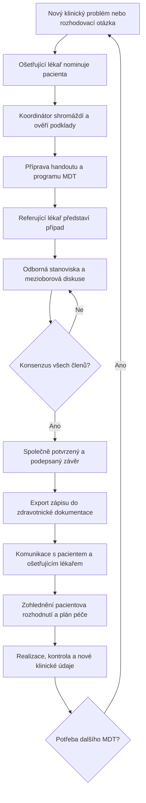

# Proces multidisciplinárního onkologického konzilia (MDT)

**Účel:** Procesní popis toho, jak probíhá projednání onkologického pacienta v multidisciplinární komisi, včetně přípravy, následných kroků a opakovaného projednávání. **Bez návrhu funkcí nebo architektury MDT Copilotu.** Dokument je určen jako doménový kontext pro tým a vývojové agenty.

**Podklady:** Soutěžní zadání *MDT Copilot – Asistovaná interpretace pro multidisciplinární onkologické konzilium* (Asseco CE), tři konzultace zaznamenané 16. 10. 2026, následné upřesnění zadavatele tohoto dokumentu.

**Status:** Rekonstrukce procesu z uvedených podkladů, nikoli obecně platný předpis pro všechny nemocnice. Konkrétní organizace se liší i mezi komisemi v jedné nemocnici. **Výslovně potvrzeno: finální závěr v popisovaném procesu vyžaduje konsenzus všech členů komise.** Předsedající tedy může jednání řídit, ale nemůže závěr jednostranně prosadit.

## 1. Účel a základní princip

Multidisciplinární onkologický tým (MDT, indikační onkologická komise) společně posuzuje **konkrétní klinický problém nebo otázku** týkající se pacienta a formuluje odborně zdůvodněné doporučení dalšího postupu.

Nejde jen o okamžik zasedání. Jedno projednání tvoří celý cyklus:

**Klinický problém → nominace → příprava podkladů a komise → prezentace případu → mezioborová diskuse → konsenzus → potvrzený zápis → sdělení pacientovi → realizace a kontrola → případné další MDT.**

- Při rutinním projednávání může na pacienta připadnout přibližně **3–5 minut** (zadání výzvy). Obtížná diskuse může trvat až **zhruba 20 minut** (konzultace s medičkou).
- Komise připravuje a schvaluje **odborné doporučení**. Pacientovy preference, případné odmítnutí zákroku a skutečně realizovaný léčebný postup se musí od tohoto doporučení odlišovat.
- Pacient zpravidla nemusí být při jednání přítomen, ale podle místní praxe někdy přítomen je a může diskusi poslouchat.

## 2. Účastníci a jejich úlohy

| Role | Úloha v procesu |
| --- | --- |
| **Nominující / ošetřující lékař** | Identifikuje problém, předá případ na MDT a formuluje konkrétní otázku pro komisi. | Může se na obojí vykašlat, poslat hodně dat bez priorit, neformulvoat ani otázku.
| **Koordinátor MDT** | Přebírá a připravuje dokumentaci, vytváří přehledný *handout*, organizuje podklady, často průběžně vyplňuje strukturovaný zápis. |
| **Referující lékař** | Na zasedání stručně představí případ, otázku, historii a relevantní nálezy. Může jím být kterýkoli vhodný odborník. |
| **Odborní členové komise** | Posuzují případ ze svých specializací, společně revidují podklady, vysvětlují své nálezy, kladou otázky a hledají společné doporučení. |
| **Předsedající** | Vede a koordinuje jednání a proces potvrzení závěru. Často jím bývá onkolog; závěr je na zákaldě konsenzu všech členů komise|
| **Pacient** | Sdílí obtíže, preference a postoj k léčbě. Může se účastnit jednání (zaleží na nemocnici). Přijetí/odmítnutí léčby je jeho samostatné rozhodnutí. |

**Složení komise se mění podle diagnózy a konkrétní otázky.** Podle popsané praxe jsou běžně zastoupeni onkolog, chirurg a radiolog; často také patolog, případně internista, gastroenterolog či další potřebný odborník. Koordinátor má samostatnou organizační úlohu. Nevyvozovat z toho celostátně povinné složení. My ale máme předem dané 4 role odborníků pro náš protoyp:•	Chirurgický pohled, •	Klinická onkologie & farmakoterapie: , •	Radiologie & zobrazovací metody, •	Patologie. Těm se pak v reportu dělají sekce informací na míru pro ně/jejich odbornost (což zahrnuje nejen hlavní data, ale i odpovědi z dotazníku pro případ naší apky, rozdele systematicky pro jednotlive odborniky podle toho, co je pro ne relevantni z odpovedi dotazniku pacienta).

**Rozlišení rolí:** Nominující lékař, referující lékař, předsedající, koordinátor a odborný autor nálezu nemusí být táž osoba. Patolog, který vytvořil histologický nález, nemusí být patologem přítomným na MDT.

## 3. Před zasedáním

### 3.1 Vznik potřeby projednání a nominace

1. Během diagnostiky nebo léčby vznikne otázka, kterou má posoudit více odborností: například operabilita, volba či změna léčby, interpretace nejasného ložiska, výsledek biomarkerů, komplikace léčby nebo potřeba dalšího vyšetření.
2. **Ošetřující lékař nominuje pacienta na MDT** a poskytne konkrétně formulovanou otázku, důvod projednání a dostupný klinický kontext. Samotná diagnóza bez rozhodovací otázky není dostatečným zadáním.
3. Pro případ jsou podstatné i **předchozí závěry MDT a jejich realizace**, pokud už byl pacient projednáván.
4. Je vhodné mít zachycené známé **preference pacienta, vnímané obtíže, funkční stav, kvalitu života a případné odmítnutí určité léčby**. Zejména explicitní odmítnutí operace či systémové léčby patří do vstupních informací.

### 3.2 Shromáždění a kontrola podkladů

5. **Koordinátor shromažďuje rozsáhlou dokumentaci** a připravuje z ní přehledný podklad pro jednání (*handout* či report).
6. Mezi důležité podklady podle zadání patří zejména histologie, aktuální staging a zobrazovací nálezy, molekulární biomarkery, laboratorní výsledky, dosavadní léčba a toxicita, komorbidity, výkonnostní stav (ECOG), pacientský dotazník (PROMs), preference pacienta, předchozí závěry MDT a přesná otázka k projednání.
7. **Kontroluje se úplnost a aktuálnost** podkladů. Není-li k rozhodnutí dost informací, může být nutné podklady doplnit, případně formulovat podmíněné doporučení. Přesné lokální pravidlo odkladu projednání nebylo popsáno.
8. Odborníci by měli předem dostat možnost prostudovat relevantní dokumentaci a ideálně pacienta také osobně vyšetřit či vidět; v reálné praxi to ne vždy nastane.

### 3.3 Organizační příprava

9. Podle typu nádoru, otázky a místních pravidel se určí složení komise, předsedající, referující lékař a koordinátor. **Mechanismus obsazování rolí ani výběru jednotlivých lékařů podklady nespecifikují.**
10. Připraví se **program zasedání** (které případy se budou projednávat). Neznáme konkrétní pravidlo jejich řazení.
11. Pro každý případ existuje **přehledný podklad pro společnou orientaci**, popřípadě odborně zaměřené části pro jednotlivé specializace. V zadání je předpokládána rychlá orientace v úvodním souhrnu během přibližně 30 sekund.

## 4. Průběh samotného zasedání

### 4.1 Zahájení případu a referování

1. Předsedající / organizátor přejde k příslušnému případu podle programu.
2. **Referující lékař představí pacienta a otázku**, dosavadní průběh nemoci, aktuální problém, významné nálezy a dosavadní léčbu.
3. Členové mají k dispozici připravený **souhrnný report/handout** s podklady, klinickou časovou osou a relevantními zprávami. Společně mohou probírat také skutečné zobrazovací snímky. *(Hackathonový dataset obsahuje jen textové popisy zobrazovacích vyšetření, což je omezení datasetu, nikoli běžného klinického postupu.)*
4. Je nutné zohlednit **pohled pacienta**: příznaky a jejich vývoj, jeho životní priority, kvalitu života a již známý souhlas či nesouhlas s konkrétní variantou.

### 4.2 Odborná stanoviska a mezioborová diskuse

5. Jednotliví odborníci se **postupně vyjádří** z hlediska své odbornosti (například chirurgické proveditelnosti, radiologického nálezu, systémové léčby či patologických výsledků).
6. **Následují vzájemné otázky.** Lékař často potřebuje vysvětlení informací mimo svou specializaci, které ovlivňují jeho vlastní posudek.
7. Posuzují se **možné varianty dalšího postupu**, jejich přínosy a rizika, další potřebná vyšetření, relevantní doporučené klinické postupy, případně klinické studie, pacientův aktuální stav a preference.
8. Významné nejistoty, rozpory v dokumentaci a chybějící podklady mohou být v průběhu diskuse vysvětleny nebo označeny jako úkol k dovyšetření.
9. **Zápis vzniká průběžně, nikoli až po skončení jednání.** Koordinátor zpravidla doplňuje klíčové údaje, diskutované možnosti a postupně se formující závěr do připravené strukturované tabulky / formuláře.

### 4.3 Konsenzus všech členů a formální potvrzení

10. Komise hledá **jedno společné odborné stanovisko**. Neshody se řeší pokračující diskusí a doplňujícími dotazy, nikoli jednostranným rozhodnutím předsedajícího.
11. **Konečný závěr je dosažen až konsenzem všech členů komise.** V potvrzeném procesu se všichni členové s finálním zněním ztotožní a **všichni jej podepíší / potvrdí**.
12. Závěr obsahuje doporučený postup včetně případných podmínek (například dovyšetření před léčbou), zdůvodnění a termínu kontroly či nového posouzení. Výsledný zápis se dokončí a schválí.
13. Podle oficiálního zadání lze v dokumentaci zachytit **odlišná odborná stanoviska z diskuse**. To není totéž jako platnost finálního závěru bez souhlasu některého člena: **pro potvrzený závěr je zde vyžadována shoda všech**.

**Nevyjasněný krajní případ:** Podklady neříkají, jaká formální procedura následuje, pokud se ani po další diskusi konsenzus nepodaří dosáhnout. Nelze automaticky předpokládat většinové hlasování, přehlasování předsedou nebo podpis závěru bez souhlasu všech.

## 5. Výsledný zápis a jeho podoba

**Zápis je zároveň oficiálním dokumentovaným výstupem MDT.** Pracuje se se **strukturovanou, předem připravenou šablonou** (šablona je přitomna v docs/template_zaver_zasedani). Podklad pro jednání a závěrečný zápis mohou tvořit části jednoho dokumentu, avšak pracovní nálezy, diskutované varianty a **schválený závěr** musí zůstat rozlišitelné.

Obsah, který vyplývá ze zadání a konzultací:

| Součást | Co zachycuje |
| --- | --- |
| Identifikace případu | Pacient, zasedání a relevantní diagnózy. |
| **Otázka odesílajícího lékaře** | Proč se případ na komisi řeší, jaký problém má komise posoudit. |
| Klinický souhrn | Podstatná anamnéza, nálezy, staging, biomarkery, dosavadní léčba, výkonnostní stav, důležitá klinická časová osa. |
| Pacientský pohled | Relevantní obtíže, preference, případné odmítnutí léčebné modality. |
| Přítomní členové a odbornosti | Složení komise, identita účastníků a předsedajícího. Zadání požaduje zaznamenat také údaje o kvóru, nikoliv však jeho číselnou definici. |
| Zvažované možnosti | Klinické alternativy, relevantní doporučené postupy a možné studie. |
| **Konsenzuální závěr** | Jednoznačně formulované společné doporučení a jeho odůvodnění. |
| Návazný plán | Potřebná vyšetření, léčba, odpovědnosti, termíny, kontrola/re-evaluace. |
| Potvrzení | Souhlas a podpis/potvrzení **všech členů komise**. |

Oficiální zadání počítá také s uvedením souladu či odchylky od guidelines (včetně důvodu odchylky), s případnými odlišnými stanovisky v diskusi a informací o zařazení do klinické studie.

**Po potvrzení musí být finální závěr vyexportovatelný v předem stanoveném dokumentovém formátu/šabloně**, například jako **PDF** nebo jako **HL7 FHIR** záznam pro zdravotnickou dokumentaci. V nemocniční praxi má být možné převést výsledek do příslušného **nemocničního informačního systému (NIS)**. Tato podmínka popisuje požadovaný výstup procesu, nikoli způsob technické realizace.

## 6. Po zasedání: pacient, provedení rozhodnutí a kontrola

1. **Výsledek je komunikován ošetřujícímu lékaři a pacientovi.** Pacientovi se vysvětlí doporučený postup a relevantní alternativy. Komunikace s pacientem se může částečně odehrát už před MDT; konkrétní posloupnost není vždy stejná.
2. **Konsenzus lékařů nezastupuje souhlas pacienta.** Pokud pacient doporučenou léčbu odmítne (typicky operaci), je třeba jeho odmítnutí zaznamenat a oddělit odborně preferovaný postup od pacientem akceptovatelné alternativy.
3. V takové situaci se může postup upravit nebo se pacientovi doporučená alternativa znovu vysvětlí při dalším setkání. Nesmí se zpětně tvrdit, že komise doporučila něco jiného jen proto, že pacient původní doporučení nepřijal.
4. Po přijetí realizovatelného plánu následují **konkrétní vyšetření, léčebné kroky, úkoly, termíny a odpovědnosti**. Výsledek se zaznamená do zdravotnické dokumentace.
5. Kontroluje se **provedení doporučených kroků a vývoj stavu**. Může být stanoven termín dalšího vyšetření, restagingu nebo nového posouzení na MDT.

**Důležité rozlišení čtyř stavů:**

- **Doporučení MDT:** co konsenzuálně doporučili specialisté.
- **Rozhodnutí/preference pacienta:** s čím souhlasí, co odmítá nebo chce dále prodiskutovat.
- **Dohodnutý léčebný plán:** jaký postup je po zohlednění doporučení a pacienta naplánován.
- **Realizovaná péče:** co bylo skutečně provedeno, kdy a s jakým výsledkem.

## 7. Opakované projednání stejného pacienta

Pacient se na MDT **může vracet opakovaně**, například při nových výsledcích, po operaci, během či po určité linii léčby, při progresi, komplikacích nebo zásadní změně stavu.

Další jednání navazuje na:

1. **Předchozí otázku, závěr a plán** včetně toho, na čem se komise shodla.
2. **Informaci o realizaci předchozího doporučení** a případném odmítnutí léčby pacientem.
3. **Nově získané podklady** (vyšetření, klinický vývoj, odpověď na léčbu, nové PROMs).
4. **Aktuální klinickou otázku**, která má být nyní rozhodnuta.

Následuje znovu příprava, prezentace, odborná diskuse, konsenzus všech členů, společné potvrzení, zápis a navazující realizace. **Nový závěr nepřepisuje historický závěr**; musí zůstat dohledatelné, co bylo doporučeno při kterém zasedání.

## 8. Přehled procesu v jednom diagramu

*Diagram ukazuje běžný cyklus; nevyjadřuje úplnou právní ani organizační proceduru. Pokud konsenzus dlouhodobě nevznikne, další formální postup není v podkladech stanoven. Komunikace s pacientem a zjišťování jeho preferencí může probíhat také před MDT.*

## 9. Co je potvrzené a co se může lišit

**Potvrzené pro popisovaný proces:**

- Případ vstupuje na MDT s konkrétní klinickou otázkou.
- Koordinátor připravuje z dokumentace přehledný podklad a často vede průběžný zápis.
- Referující lékař prezentuje případ; účastníci mají k dispozici report a relevantní odborné podklady.
- Členové se postupně vyjadřují, vzájemně doptávají a diskutují alternativy.
- **Konečný závěr musí být konsenzem všech členů a musí jej všichni potvrdit.**
- Finální zápis má definovanou strukturu, je použitelný pro zdravotní dokumentaci a musí být exportovatelný v požadované šabloně/formátu.
- Závěr je následně komunikován, promítá se do léčebného plánu a jeho plnění se sleduje.
- Pacient může být řešen opakovaně; předchozí závěry jsou součástí kontextu dalšího projednání.

**Proměnlivé nebo v podkladech neuvedené:**

- Konkrétní složení komise, předsedající, obsazování rolí a pořadí pacientů v programu.
- Přítomnost pacienta, čas rozhovoru s ním a přesná posloupnost komunikace souhlasu/odmítnutí.
- Konkrétní formulář, podpisové řešení, organizace kvóra a místní procesní pravidla.
- Formální postup, pokud se nedosáhne konsenzu všech členů.

## 10. Zdroje a omezení

1. **Oficiální zadání Asseco CE:** třífázový proces před–během–po MDT, společný souhrn, odborné pohledy, Decision Support Panel, strukturovaný závěr, export a návazná realizace.
2. **Konzultace 1 (první mentor):** složení komise a předsedající, společné shrnutí a oborové podklady, zápis plánu/úkolů a potřeba exportu do zdravotnické dokumentace. Starší tvrzení, že rozhoduje předseda, je pro zde popsaný proces **nahrazeno pozdějším explicitním potvrzením konsenzu všech členů**.
3. **Konzultace 2 (datový mentor):** proměnlivé role komise a organizační odlišnosti. Technické návrhy AI a autentizace sem záměrně nepatří.
4. **Konzultace 3 (medička):** reálné složení a práce komise, koordinátor a handout, referující lékař, práce se snímky, živá diskuse, postupně vedený zápis, účast/preference pacienta, podpisy a opakovaná MDT.
5. **Následné potvrzení zadavatele tohoto dokumentu:** finální závěr musí být skutečně **konsenzuální a potvrzen všemi členy**; výstup musí mít předem definovanou šablonu a možnost exportu.

> **Poznámka ke sdílení:** Soutěžní zadání je označeno `CONFIDENTIAL (by Asseco CE)`. Před uložením odvozeného procesního dokumentu do veřejného repozitáře je vhodné ověřit povolený rozsah zveřejnění.
